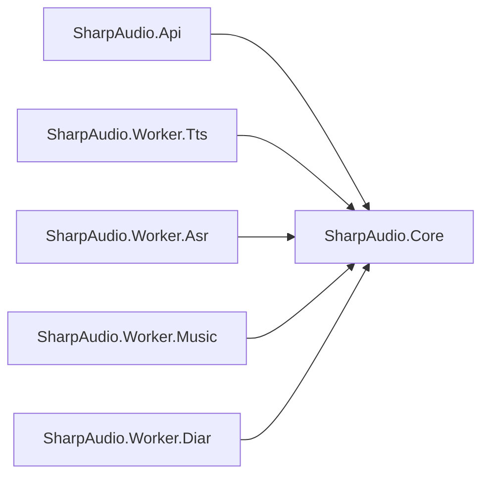

# SharpAudio Wiki — Worker Core

> Linked from [docs/LLM_WIKI.md](../LLM_WIKI.md). `SharpAudio.Core` is the single library that the
> API and every worker executable build on: contracts, models, options, engines, the model cache,
> the worker process manager and the generated gRPC contract. The API project is the HTTP surface
> only; each worker project is a thin executable (bootstrap + one gRPC service) over Core.

## Core project layout

`src/SharpAudio.Core/SharpAudio.Core.csproj` is a plain `Microsoft.NET.Sdk` library with a
`FrameworkReference` to `Microsoft.AspNetCore.App` — Core owns the worker bootstrap (Kestrel + DI +
`MapGrpcService`), so it needs the ASP.NET pipeline without being an executable project itself.
Because a plain SDK project does not carry the ASP.NET implicit usings, `GlobalUsings.cs` supplies
the ones every service relies on (`ILogger`, `BackgroundService`, `IOptions<T>`, DI).

Dependency direction is one-way:

No worker project references another worker project, and Core never references an executable. That
is what makes it possible to add a task worker (music, diarization) without touching the existing
ones.

## Shared gRPC contract

`Protos/common.proto` holds the one `HealthCheckRequest` / `HealthCheckResponse` pair that every
worker task uses. Field numbers are unchanged from the per-file copies it replaced, so the wire
format is identical; `synthesis.proto` and `transcription.proto` now import it instead of each
declaring its own copy.

Field numbers in every task proto are frozen — new fields append, never renumber. See
[backend-architecture.md](backend-architecture.md#grpc-contract) for the TTS contract and
[asr-engines.md](asr-engines.md#worker-process-di-wiring-and-server-mode) for the ASR contract.

## Worker bootstrap

Every worker executable is a few lines: parse arguments, then hand them to `WorkerHost.RunAsync<T>`.
The bootstrap is written once in Core and covers Kestrel HTTP/2 on localhost, `AddGrpc()`, the
`IdleMonitor` singleton, and the `READY:{port}` handshake that `WorkerProcessManager` reads.

Two contracts are load-bearing and must not change:

- **Argument names** — `--port`, `--model-key`, `--idle-timeout`, in the order
  `WorkerProcessManager` builds the command line.
- **The `READY:{port}` line on stdout** — matched by `READY:(\d+)`; the process manager waits on it
  before sending any request.

Idle shutdown now calls `IHostApplicationLifetime.StopApplication()` instead of `Environment.Exit(0)`,
so a request in flight is drained before the process exits, and `WaitForShutdownAsync` replaces the
fixed `Task.Delay(500)` that used to stand in for "the server is listening" — readiness is now
announced only after `StartAsync` has actually bound the port.

## Worker channel cache

`WorkerChannelCache` is the single gRPC connection owner on the API side: one channel per
worker key, clients built once per service type, and one retry path for `Unavailable`.
Message-size limits come from `WorkerTaskOptions` rather than hardcoded per-proxy values,
and disposal is handled by DI — the proxies no longer implement `IDisposable`.

## Worker service base

`WorkerServiceBase` is the shared shape of every worker gRPC service: idle tracking, the
engine pool, the `HealthCheck` response and disposal. A gRPC service must inherit its
generated base class, so this is used by composition — each per-task service holds one and
implements only the RPC dispatch (`Synthesize`, `Transcribe`, `TranscribeStream`).

## Worker task options

`WorkerTaskOptions` holds everything `WorkerProcessManager` needs. `WorkerOptions` (TTS) and
`AsrWorkerOptions` are thin subclasses that only override defaults and the config section
name, so a new worker adds a subclass instead of a duplicate option shape.

## Worker health probe

`WorkerHealthProbe` calls the shared `HealthCheck` RPC with a timeout before reusing a live
worker, throttled by `HealthProbeIntervalSeconds` so probes do not add a round trip to every
request. `WorkerProcessManager` falls back to "alive means healthy" when no probe is
registered, which keeps in-process and test usage unchanged. Program.cs registers one cache
and one probe per worker task (`"tts"` and `"asr"` keyed singletons), each with the task's
own health-check call delegate.

## Worker task descriptor

`WorkerTaskDescriptor` names one worker task: its keyed DI name, its `WorkerTaskOptions` and the
health-check call delegate for its gRPC service. `Program.cs` registers the channel cache, probe
and process manager by looping over descriptors, so a new worker adds a descriptor rather than a
copy of the registration block. Proxies resolve the same key with `[FromKeyedServices]`.

## Server mode values

`ServerMode` is the single place `SERVER_MODE` is interpreted. The names are `tts` (the default when
the variable is unset, which preserves pre-ASR behavior), `asr`, `music`, `diar`, `both` (tts + asr)
and `all` (every task). An unrecognised value enables nothing, so a typo surfaces as an empty server
rather than silently running the wrong task. `Program.cs` registers a worker task only for the tasks
the parsed mode enables, which is what keeps a music-only or diarization-only container from starting
processes it cannot use.

## Single active engine pool

`SingleActiveEnginePool` keeps at most one model engine loaded (the single-active-engine
rule): loading a different model disposes every other kind. Entries are keyed by engine kind,
so a kind that coexists with the active model — the Silero VAD engine, whose LSTM state is
independent of the ASR model — can stay loaded by passing `evictOthers: false`. Model loading
happens outside the lock, which only guards the map; a caller that misses the cache builds the
engine first and discards it if another caller installed the same kind and model in the
meantime. Inference is not serialised by the pool.

